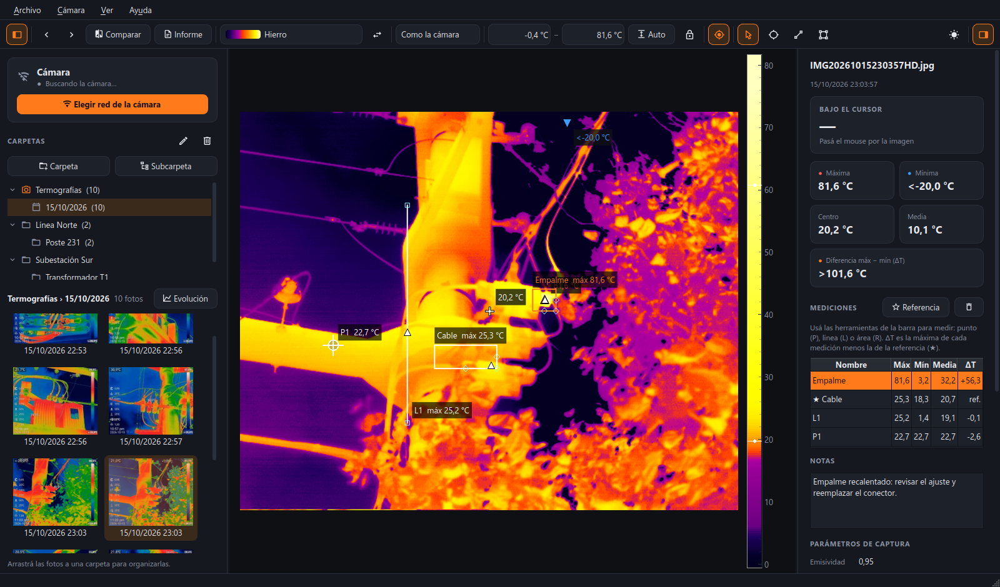
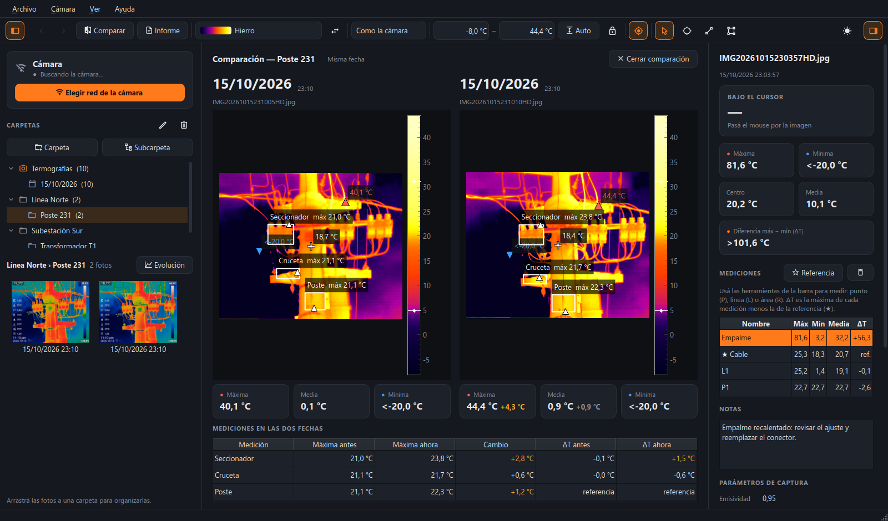
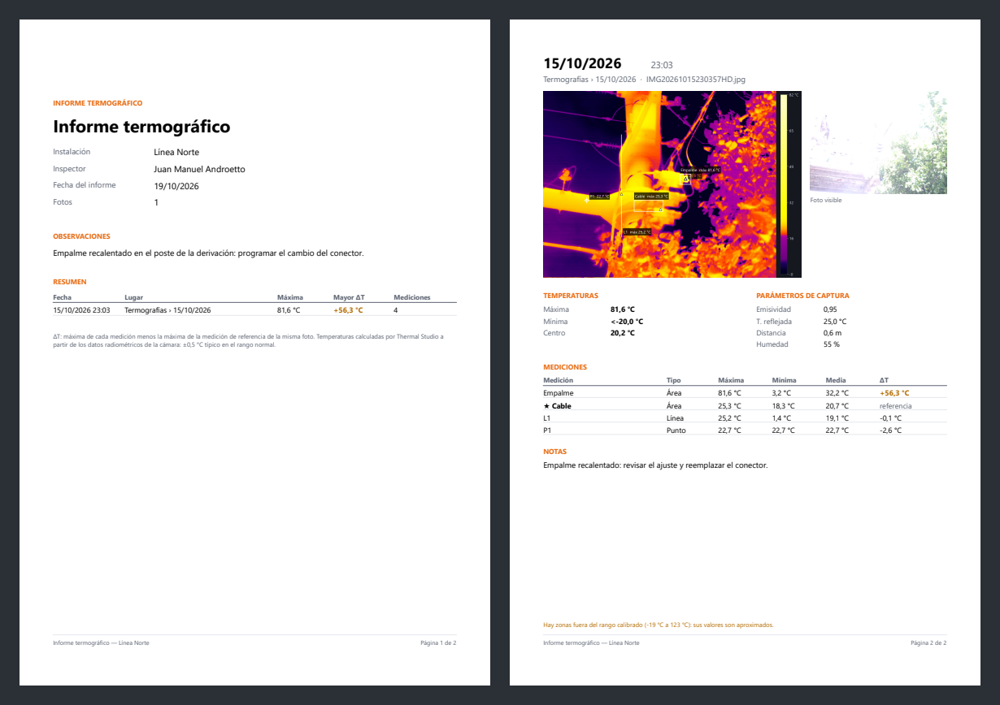

# UTi760x Thermal Studio

App de escritorio para Windows que analiza, organiza y documenta las imágenes de la cámara
termográfica **UNI-T UTi760x**. Lee los datos radiométricos reales que la cámara guarda
dentro de cada `.jpg` (640×512 temperaturas), no solo la imagen que se ve en pantalla.

**[⬇ Descargar la última versión](https://github.com/androettojuan/uti760x-thermal-studio/releases/latest)**
· Español · English · Português (Brasil)



## Qué hace

### Trae las fotos de la cámara por WiFi
El panel **Cámara** se conecta al FTP de la cámara y baja solo las fotos nuevas, sin
duplicar nunca, a `Documentos\Termografías\Importadas\<fecha>`. Si Windows no se conecta
solo a la red de la cámara, el botón la elige; si la cámara no le da dirección a la PC,
avisa y ofrece **Reconectar**.

### Organiza: una carpeta por lugar
Una carpeta por equipo o instalación (por ejemplo *Línea Norte › Poste 231*) y arrastrar
las fotos de cada recorrida. La galería muestra la fecha y hora de cada foto; con clic
derecho se mueve, se compara o se manda a la papelera.

### Mide
- **Bajo el cursor**, **máxima**, **mínima** y **centro**, marcados como en la cámara.
  Fuera de lo que mide la cámara se muestra igual que ella: `<-20,0 °C` / `>125,0 °C`.
- Herramientas de **punto (P)**, **línea (L)** con perfil de temperatura y **área (R)**.
- **ΔT contra una referencia (★)**: cuánto más caliente está cada punto que otro igual
  que trabaja bien. Es lo que menos cambia entre verano e invierno y lo que indica una
  falla, como el empalme a +56 °C de la captura.
- **Notas** por foto, que se guardan solas y salen en el informe.
- Las **10 paletas** de la cámara, contraste *como la cámara* (reparte los colores para
  ver detalles) o *lineal*, rango automático que ignora el cielo, y la foto visible en
  grande.

### Sigue un lugar en el tiempo
**Comparar (C)** pone dos fotos del mismo lugar lado a lado con la misma escala de
colores, la fecha bien grande y una tabla que cruza las mediciones del mismo nombre:
máxima antes y ahora, cuánto cambió y el ΔT de cada fecha. **Evolución (E)** grafica la
máxima y el ΔT de cada medición en todas las fotos de la carpeta.



### Informe PDF y exportación
**Informe (Ctrl+P)**: carátula con instalación, inspector, observaciones y resumen, y una
página por foto con la térmica y sus mediciones, la foto visible, los parámetros de
captura, la tabla de mediciones con ΔT y las notas. También exporta la imagen con
mediciones (PNG) y las mediciones o la matriz completa de temperaturas (CSV para Excel).



### Idiomas y unidades
Español, inglés y portugués de Brasil: el instalador pregunta el idioma y se cambia en
*Ver → Idioma*. Números, fechas y CSV siguen el formato de cada idioma. Temperaturas en
**Celsius** (por defecto) o **Fahrenheit**, en *Ver → Unidad de temperatura*. Tema oscuro
o claro.

## Precisión

La conversión de los datos crudos a grados usa la forma física de la radiación (Planck),
corregida por la temperatura del sensor, la emisividad y la temperatura reflejada de cada
foto. Está ajustada con 263 lecturas de la pantalla de la cámara en 177 fotos, exports
del software de UNI-T y la tabla de calibración de fábrica que trae cada foto.

| | Diferencia con la pantalla de la cámara |
|---|---|
| Típica (rms) | **0,5 °C** (0,4 °C arriba de 50 °C) |
| Máxima | 1,3 °C |
| Rango validado | −19 a 123 °C (rango normal de la cámara) |

Bajo cero queda una variación de hasta ~1 °C entre una sesión y otra que viene de la
propia cámara (nada en el archivo la explica) y está dentro de los ±2 °C que declara el
fabricante. Las fotos sacadas en el **rango alto** de la cámara todavía no están
calibradas y la app lo avisa. El detalle está en
[`docs/formato_uti760x.md`](docs/formato_uti760x.md).

## Instalación

Descargá `ThermalStudio-X.Y.Z-instalador.exe` desde
[Releases](https://github.com/androettojuan/uti760x-thermal-studio/releases/latest) y
ejecutalo. Requiere Windows 10/11 de 64 bits y se instala sin permisos de administrador.
Como el instalador no está firmado, Windows puede mostrar «Windows protegió su PC»: clic
en *Más información* → *Ejecutar de todas formas*.

### Conectar la cámara
1. En la cámara, **pasá las fotos a la carpeta FTP**: el programa solo ve las que están ahí.
2. Activá el WiFi (punto de acceso) y el FTP de la cámara.
3. En el programa, **Elegir red de la cámara** (o conectá la PC a esa red a mano) y, cuando
   diga *Conectada*, **Traer faltantes**.

Por defecto usa `192.168.32.1:2121` con usuario y contraseña `admin` / `admin`; se cambia
en *Cámara → Configurar conexión…*. La guía rápida y los atajos están en *Ayuda* (F1).

## English

Desktop app for Windows to analyze, organize and report thermal images from the
**UNI-T UTi760x** camera, using the real per-pixel temperatures stored in each photo:
Wi-Fi import, one folder per location, point/line/area measurements with **ΔT against a
reference**, side-by-side comparison and trend over time, PDF reports and CSV export.
Available in English, Spanish and Brazilian Portuguese (the installer asks for your
language), in Celsius or Fahrenheit. Typical accuracy is 0.5 °C against the camera's own
display, validated from −19 to 123 °C.
[Download it from Releases](https://github.com/androettojuan/uti760x-thermal-studio/releases/latest).


## Desde el código

Requiere Python 3.11 o superior.

```bash
python -m venv .venv
.venv/bin/pip install -r requirements-app.txt     # en Windows: .venv\Scripts\pip
.venv/bin/python -m thermal_studio                # opcional: ruta a una foto .jpg
.venv/bin/python -m pytest tests                  # tests
```

- `thermal_studio/core/`: formato de la cámara, conversión a grados, biblioteca,
  importación, mediciones y exportación. Sin dependencias de Qt.
- `thermal_studio/ui/`: interfaz (PySide6 + pyqtgraph) e informe PDF.
- `thermal_studio/idiomas/`: traducciones (el texto en castellano es la clave).
- `herramientas/`: scripts y datos con los que se sacaron las paletas, la calibración y
  las capturas de este README.
- `docs/formato_uti760x.md`: cómo está armado el archivo de la UTi760x.

### Publicar una versión
1. Si cambió algo que se ve o que dice este README, actualizarlo y regenerar las
   capturas: `PYTHONPATH=. .venv/bin/python herramientas/capturas/capturas.py`.
2. Actualizar `__version__` en `thermal_studio/__init__.py`.
3. Subir la etiqueta `vX.Y.Z`: GitHub Actions corre los tests, compila el instalador y
   crea el Release (`.github/workflows/instalador-windows.yml`).

## Licencia

MIT © 2026 Juan Manuel Androetto. Ver [LICENSE](LICENSE).

¿Te sirve Thermal Studio? [Invitame un cafecito ☕](https://cafecito.app/voltacore)
